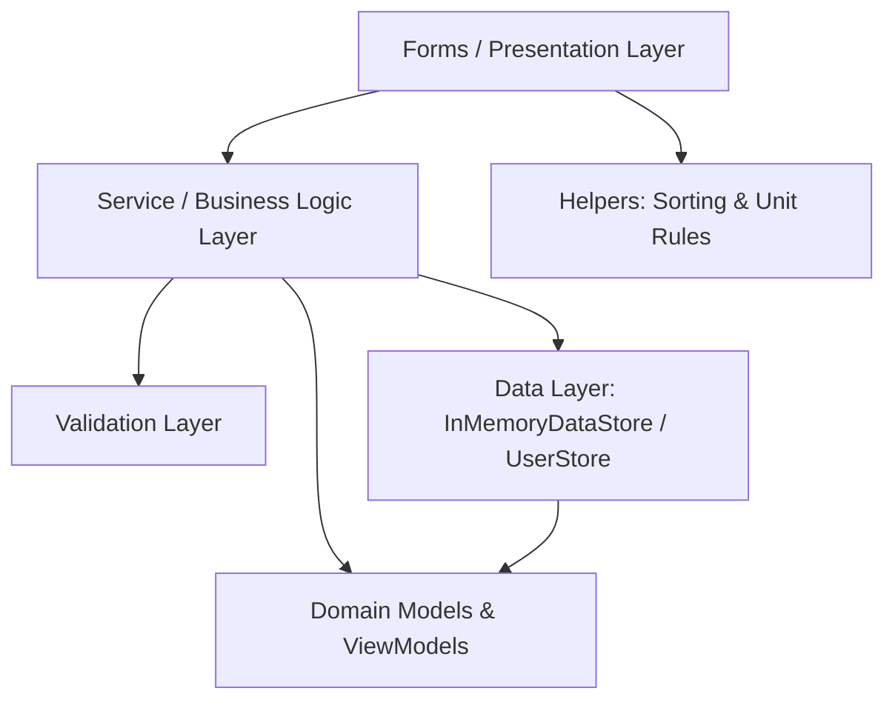

# Inventory Management System (IMS) - Technical Documentation

**Course:** Event-Driven Programming  
**Phase:** Phase 1 – Windows Forms Desktop Application (In-Memory Collections)  
**Target Framework:** .NET 8.0 Windows Desktop (`net8.0-windows`)  
**Language:** C# 12.0  

---

## Table of Contents
1. [System Overview & Architecture](#1-system-overview--architecture)
2. [Folder & File Structure](#2-folder--file-structure)
3. [Data Storage Mechanism (In-Memory Local Storage)](#3-data-storage-mechanism-in-memory-local-storage)
4. [Validation Architecture & Rules](#4-validation-architecture--rules)
5. [Core Business Logic & Event-Driven Workflows](#5-core-business-logic--event-driven-workflows)
6. [User Interface & Navigation Architecture](#6-user-interface--navigation-architecture)
7. [How to Run and Test](#7-how-to-run-and-test)

---

## 1. System Overview & Architecture

The **Inventory Management System (IMS)** is a multi-tier, event-driven desktop application built for small businesses to record and monitor products, suppliers, stock movements (received, issued, adjusted), and inventory availability.

### Architecture Pattern: Clean Layered Design
The codebase is structured following a strict separation of concerns into distinct layers:



1. **Presentation Layer (`Forms/`)**: User interface built with Windows Forms. Handles UI rendering, user input events, master-detail displays, dynamic navigation stacks, and control state management.
2. **Business Logic Layer (`Services/`)**: Intermediary coordinating domain operations, applying business constraints (such as preventing duplicate codes, verifying stock levels, and enforcing referential integrity).
3. **Validation Layer (`Validators/`)**: Independent, testable static classes validating input data integrity before domain actions occur.
4. **Data Layer (`Data/`)**: Emulates database storage using strongly-typed, in-memory generic collections (`List<T>`) and thread-safe identity generators.
5. **Domain & View Models (`Models/`)**: Core entities, data transfer objects (DTOs), and enumerations representing system concepts.
6. **Helpers (`Helpers/`)**: Cross-cutting utilities for column sorting in `ListView` and unit-of-measure rules.

---

## 2. Folder & File Structure

Below is the complete inventory of folders and files in the project, accompanied by their specific roles:

```
InventoryManagementSystem/
│
├── Data/                             # In-memory storage & seeding
│   ├── InMemoryDataStore.cs          # Central repository for business entities
│   ├── UserStore.cs                  # Storage repository for user accounts
│   └── SampleData.cs                 # Seed data generator for demo & testing
│
├── Models/                           # Data models & entity definitions
│   ├── Enums.cs                      # TransactionType, AdjustmentReason, ProductStatus
│   ├── UserRole.cs                   # UserRole enum (Admin, User)
│   ├── User.cs                       # User account model (Id, Username, Password, Role)
│   ├── Category.cs                   # Product category entity
│   ├── Supplier.cs                   # Supplier entity (Contact, Phone, Email, Address)
│   ├── Product.cs                    # Product entity (Pricing, stock levels, supplier ref)
│   ├── StockTransaction.cs           # Immutable stock audit entry
│   ├── StockTransactionView.cs       # Flattened view model for transaction displays
│   ├── TransactionListItem.cs        # Compact summary item for dashboard recent lists
│   ├── DashboardSummary.cs           # KPI metrics container (counts, valuation, alerts)
│   └── LowStockItem.cs               # Alert item model for low-stock products
│
├── Validators/                       # Pure validation logic & business constraints
│   ├── UserValidator.cs              # Validates username, password, full name
│   ├── ProductValidator.cs           # Validates product code, prices, units, supplier ref
│   ├── CategoryValidator.cs          # Validates category names and descriptions
│   ├── SupplierValidator.cs          # Validates phone, email, and required supplier data
│   └── StockTransactionValidator.cs  # Validates transaction quantities and reasons
│
├── Services/                         # Business operations & domain workflows
│   ├── AuthService.cs                # Login, registration, credential validation
│   ├── ProductService.cs             # Product catalog searching, filtering, CRUD
│   ├── CategoryService.cs            # Category management & product association checks
│   ├── SupplierService.cs            # Supplier management & relational checks
│   ├── StockService.cs               # Core stock in, stock out, and adjustment operations
│   ├── StockTransactionService.cs    # Transaction queries and filtering
│   ├── TransactionService.cs         # Low-level transaction logging adapter
│   ├── DashboardService.cs           # KPI calculations and summary generation
│   └── ReportService.cs              # Inventory valuation & movement report logic
│
├── Helpers/                          # Cross-cutting UI and utility helpers
│   ├── ListViewItemComparer.cs       # Custom IComparer for sorting WinForms ListViews
│   └── ProductUnits.cs               # Unit definitions and fractional quantity rules
│
├── Forms/                            # Presentation layer (Windows Forms)
│   ├── Auth/
│   │   ├── LandingForm.cs            # Welcome screen with Login / Register buttons
│   │   ├── LoginForm.cs              # Modal dialog for user sign-in
│   │   └── RegisterForm.cs           # Modal dialog for new user account registration
│   ├── Dashboard/
│   │   └── DashboardForm.cs          # Main host shell with sidebar, KPIs, and embedded subviews
│   ├── Products/
│   │   └── ProductsForm.cs           # Master-detail product catalogue & management
│   ├── Categories/
│   │   └── CategoriesForm.cs         # Category management form
│   ├── Suppliers/
│   │   └── SuppliersForm.cs          # Supplier management form
│   ├── StockIn/
│   │   └── StockInForm.cs            # Stock receiving form (increases quantity)
│   ├── StockOut/
│   │   └── StockOutForm.cs           # Stock issue/sales form (decreases quantity)
│   ├── StockAdjust/
│   │   └── StockAdjustmentForm.cs    # Stock reconciliation & discrepancy adjustment
│   ├── Transactions/
│   │   └── TransactionsForm.cs       # Transaction history and audit log viewer
│   └── Reports/
│       └── ReportsForm.cs            # Inventory valuation & low-stock reports
│
├── Program.cs                        # Application bootstrap, DI setup & unhandled error handlers
└── InventoryManagementSystem.csproj  # Project configuration & target framework
```

---

## 3. Data Storage Mechanism (In-Memory Local Storage)

In Phase 1, data persistence is maintained in memory without an external relational database or file disk store.

### 3.1 The In-Memory Data Store Architecture
The class `InMemoryDataStore` (`Data/InMemoryDataStore.cs`) acts as an in-memory database context holding the primary collections:

```csharp
public class InMemoryDataStore
{
    private int nextCategoryId = 1;
    private int nextSupplierId = 1;
    private int nextProductId = 1;
    private int nextTransactionId = 1;

    public List<Category> Categories { get; } = new List<Category>();
    public List<Supplier> Suppliers { get; } = new List<Supplier>();
    public List<Product> Products { get; } = new List<Product>();
    public List<StockTransaction> Transactions { get; } = new List<StockTransaction>();
    ...
}
```

### 3.2 Key Characteristics:
1. **Generic In-Memory Collections (`List<T>`)**:
   Entities are stored as objects in strongly-typed lists. Mutations (adding, updating, removing) take effect across the entire runtime session.
2. **Auto-Increment Primary Key Generation**:
   Private sequence counters (`nextProductId`, `nextCategoryId`, etc.) guarantee unique integer IDs, mimicking SQL `IDENTITY` or `AUTO_INCREMENT` columns.
3. **Single Context Lifecycle via Constructor Dependency Injection**:
   In `Program.cs`, a single instance of `InMemoryDataStore` and `UserStore` is instantiated at boot:
   ```csharp
   UserStore userStore = new UserStore();
   AuthService authService = new AuthService(userStore);
   InMemoryDataStore dataStore = new InMemoryDataStore();
   SampleData.Load(dataStore); // Seeds initial categories, suppliers, products, and movements
   Application.Run(new LandingForm(userStore, authService, dataStore));
   ```
   This single instance is handed down to forms and services, ensuring that adding a product in `ProductsForm` or receiving stock in `StockInForm` immediately updates the shared state seen by `DashboardForm`, `ReportsForm`, and `TransactionsForm`.

4. **Default Seeding (`SampleData.cs`)**:
   Upon startup, the system seeds:
   - 4 Categories (Electronics, Office Supplies, Furniture, Cleaning)
   - 3 Suppliers (TechSource Ltd, OfficeMart, Comfort Furnishings)
   - 7 Products with categories, assigned suppliers, barcodes, and minimum stock levels
   - 30 days of stock transactions (Opening balances, Stock In, Stock Out, Adjustments)
   - Default administrator user account (`admin` / `admin123`)

---

## 4. Validation Architecture & Rules

Validation is structured in a two-tier defense pattern:

```
[User Input in WinForms Controls]
          │
          ▼ Tier 1: UI Input Parsing (TryReadDecimal, required fields check)
[UI Form Event Handlers]
          │
          ▼ Tier 2: Domain Business Rules
[Static Validators (ProductValidator, UserValidator, etc.)]
          │
     ┌────┴────┐
  Valid?     Invalid?
     │         │
     ▼         ▼
[Execute Service]  [Display Friendly Error Label / Message Box]
```

### 4.1 Product Validation (`Validators/ProductValidator.cs`)
- **Product Code**: Mandatory, trimmed, maximum 30 characters.
- **Product Name**: Mandatory, minimum 2 characters, maximum 100 characters.
- **Category Selection**: Must have a valid category selected (`CategoryId > 0`).
- **Supplier Selection**: Must have a valid registered supplier selected (`SupplierId > 0`).
- **Unit Selection**: Must be selected from pre-approved units in `ProductUnits.All`.
- **Financial Values**: Purchase cost and selling price cannot be negative.
- **Stock Levels**: Initial quantity and minimum stock cannot be negative.
- **Discrete Unit Integrity**: For units like `piece`, `box`, `bottle`, or `ream`, quantities must be integers (decimals are rejected). For continuous units like `kg`, `liter`, or `meter`, decimal quantities are permitted.
- **Length Limits**: Barcode / SKU ≤ 50 chars, Location ≤ 100 chars, Description ≤ 200 chars.

### 4.2 User Authentication Validation (`Validators/UserValidator.cs`)
- **Username**: Mandatory, minimum 3 characters, maximum 30 characters, alphanumeric only.
- **Password**: Mandatory, minimum 4 characters, maximum 50 characters.
- **Full Name**: Mandatory, minimum 2 characters, maximum 100 characters.

### 4.3 Stock Transaction Validation (`Validators/StockTransactionValidator.cs`)
- **Quantity**: Must be strictly positive (`quantity > 0`).
- **Adjustment Reason**: If transaction type is `Adjustment`, an adjustment reason (`Damaged`, `Expired`, `Lost`, or `Found`) must be provided.

---

## 5. Core Business Logic & Event-Driven Workflows

### 5.1 Product Management Logic (`ProductService.cs`)
- **Unique Code Enforcement**: When adding or renaming a product, the code is cross-referenced against all existing products (case-insensitive) to prevent duplicate SKUs.
- **Relational Integrity on Delete**: A product cannot be deleted if transactions exist for it; the user is instructed to mark it `Inactive` instead.
- **Multi-Criteria Search & Filter**:
  The `Search(text, categoryId, supplierId, status, lowStockOnly)` method filters products by:
  - Text search matching Code, Name, Barcode, or Supplier Name.
  - Selected Category filter.
  - Selected Supplier filter.
  - Active/Inactive status.
  - Low-stock status flag (`Quantity <= MinimumStock`).

### 5.2 Stock Movement Logic (`StockService.cs`)
All stock transactions are audited with full transaction records:
1. **Stock In (`ReceiveStock`)**:
   - Increases product quantity: `product.Quantity += quantity`.
   - Records an immutable `StockTransaction` of type `TransactionType.StockIn` with the supplier ID, date, unit cost, and notes.
2. **Stock Out (`IssueStock`)**:
   - Validates that requested quantity does not exceed current stock:
     ```csharp
     if (product.Quantity < quantity)
     {
         return "Insufficient stock. Available quantity is " + product.Quantity + ".";
     }
     ```
   - Decreases product quantity: `product.Quantity -= quantity`.
   - Records an immutable `StockTransaction` of type `TransactionType.StockOut` with negative quantity.
3. **Stock Adjustment (`AdjustStock`)**:
   - Reconciles physical count with system count.
   - For shrinkage (Damaged, Expired, Lost), quantity decreases.
   - For surplus (Found), quantity increases.
   - Records transaction with the corresponding `AdjustmentReason`.

### 5.3 Supplier Relationship & Deletion Guard (`SupplierService.cs`)
- Each product is associated with a supplier selected from registered suppliers.
- **Foreign Key Protection**: When deleting a supplier, `SupplierService.Delete(id)` verifies:
  1. No products are currently assigned to this supplier (`GetProductCount(id) == 0`).
  2. No historical stock transactions reference this supplier (`GetTransactionCount(id) == 0`).
  If either check fails, the deletion is aborted with a descriptive message.

### 5.4 Dashboard & Real-Time KPI Logic (`DashboardService.cs`)
Calculates real-time business health indicators:
- **Total Products**: Count of registered products.
- **Total Categories**: Count of active product categories.
- **Low Stock Count**: Number of active products where `Quantity <= MinimumStock`.
- **Total Stock Value**: Sum of `(Product.Quantity * Product.PurchaseCost)`.
- **Recent Transactions**: Last 5 stock movements.
- **Low Stock Alerts**: List of items needing replenishment.

---

## 6. User Interface & Navigation Architecture

### 6.1 Landing & Authentication Flow
- The application launches into `LandingForm`.
- Clicking **Login** hides `LandingForm` and opens `LoginForm` as a modal dialog (`ShowDialog()`).
- On successful login, the `DashboardForm` is shown with the user's role and full name.
- When `DashboardForm` is closed (e.g. logging out or exiting), `LandingForm` reappears seamlessly.

### 6.2 Host Shell & Breadcrumb Stack Navigation
`DashboardForm` acts as an Application Shell containing:
- **Header**: Current page title, subtitle, back button, and real-time live clock timer.
- **Left Sidebar**: Quick navigation buttons for all modules.
- **Content Area**: Dynamic panel where forms are embedded without modal popups by setting:
  ```csharp
  childForm.TopLevel = false;
  childForm.FormBorderStyle = FormBorderStyle.None;
  childForm.Dock = DockStyle.Fill;
  contentPanel.Controls.Add(childForm);
  ```
- **Navigation History Stack (`Stack<Control>`)**:
  Pushing views onto a stack allows the **Back** button to navigate backward through previously visited pages until returning to the Home Dashboard view.

### 6.3 ListView Sorting Helper (`ListViewItemComparer.cs`)
All data tables use standard WinForms `ListView` controls with sorting enabled on column clicks. `ListViewItemComparer` automatically detects whether values are numeric (e.g. prices, quantities, stock levels) or textual, sorting numbers mathematically and strings alphabetically in ascending/descending order with boundary safety.

---

## 7. How to Run and Test

1. Open `InventoryManagementSystem.sln` in **Visual Studio 2022**.
2. Press **F5** (or click **Start**) to build and run the application.
3. **Demo Credentials**:
   - **Admin User**: Username `admin`, Password `admin123`
   - Alternatively, click **Register** on the landing screen to create a new user account.
4. Test the primary flows:
   - **Products**: View all 13 details in the list, click headers to sort, select a supplier from the registered suppliers, and add or update products.
   - **Stock In / Stock Out**: Record shipments and observe stock quantities and dashboard KPIs update in real time.
   - **Reports**: View overall stock valuation and print/export low stock items.
